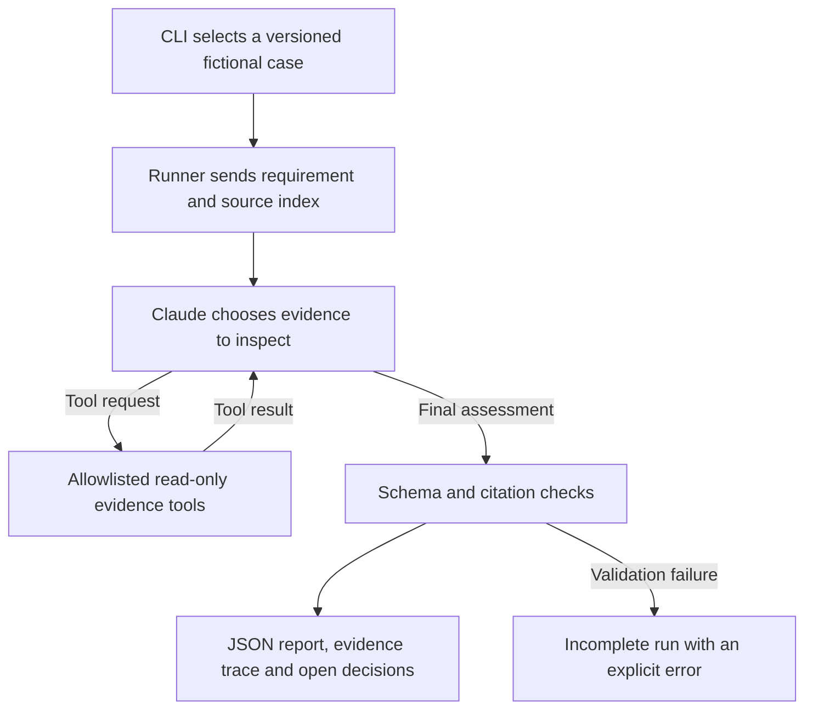

# POC architecture and verification

## Runtime responsibilities

- **AI** chooses follow-up lookups and interprets requirements, evidence and impacts.
- **Backend** controls the evidence boundary, tool argument checks, request budget, OpenAPI field extraction, deterministic citation verification and run status. Search returns metadata. A read is required before a citation is accepted. The model gets neither shell access nor general file or network access.
- **Human** determines whether excerpts actually support the reasoning and resolves open decisions. A quote matching a source does not prove that the claim follows from it.

The live runner uses a six-tool default budget, at most seven model calls, and a 90-second default time budget. The deadline is checked between model calls, with remaining time passed to the HTTP client as its request timeout. This is a CLI POC, not a hard process time limit. One fixed provider endpoint is used and redirects are refused. No vector store, external orchestration framework or model training is needed.

## Run record

Each run includes a run ID, case fingerprint, requested model, returned model metadata when available, prompt/report versions, model-call stop reasons, usage, duration, tool names and source IDs. The report carries an explicit evidence status per claim and open human decisions. The trace includes tool results by reference and exact excerpts that were read, not hidden reasoning. API credentials are not persisted. Keep reports generated from this repo synthetic.

## What the controls do and do not prove

- An excerpt of the correct type, actually read during the run, is required for a supported implementation/contract/policy claim. That check catches policy-as-implementation and fabricated quotes, not every possible semantic error.
- The missing-excerpt case changes the case fingerprint and removes the implementation source from the inventory. The offline fixture demonstrates the expected supported → unverified distinction. Both live cases require a real model run and human inspection.
- Passing offline tests verifies runner behavior under the tested conditions. It does not verify live model availability, output quality, productivity or ROI.
- A completed run means the technical validation passed. It is not a readiness approval.

## Next increment after a live run

Port or invoke QUAESTOR in a fresh review context using only the requirement, permitted evidence and finalized report. Compare a single-pass Claude baseline with the adaptive workflow on the same source corpus and exact model. Keep reference answers outside all model runtime inputs. Record material recall, precision, citation fidelity, missed decisions, time and cost. Measure active human review effort separately before making an ROI claim.
